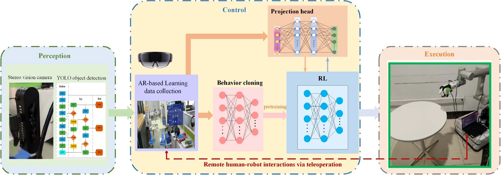

# Scalable Dexterous Robot Learning with AR-based Remote Human-Robot Interactions

**IEEE Transactions on Industrial Electronics, 2026**

[Project page](https://cyberyyc.github.io/) · [Paper](https://doi.org/10.1109/TIE.2026.3713549) · [arXiv](https://arxiv.org/abs/2602.07341)

AR-based remote demonstrations initialize dexterous manipulation policies through behavior cloning. A second stage refines the actor with Soft Actor-Critic and an expert-paired contrastive projection objective.

## Core modules

- `core/behavior_cloning.py`: supervised pretraining of the SAC actor on expert state–action pairs.
- `core/contrastive_sac.py`: SAC updates, expert-action pairing, and the training-time projection head.
- `core/rewards.py`: distance, progress, event, and hand-pose reward components.
- `examples/two_stage_training.py`: connects the two learning stages through an environment factory.
- `paper_config.json`: network dimensions and principal paper hyperparameters.

## Method and interfaces

1. Collect aligned expert observations and actions through the AR interaction interface.
2. Pretrain the actor with behavior cloning.
3. Continue training with SAC and the expert-paired contrastive objective.
4. Execute the learned actor; the projection head is only used for training.

The paper uses a **20-dimensional observation** and **8-dimensional action**. Actor and critic hidden layers are 256–256. The action projection head is 256–256–128, with contrastive temperature 0.1 and objective weight 0.5. Expert arrays have shapes `(N, 20)` and `(N, 8)`. Store aligned transitions as `observations` and `actions` in an NPZ file; actions use the environment's native action bounds and are scaled internally for the SAC actor.

Install dependencies with `python -m pip install -r requirements.txt`. The training entry point accepts an environment factory (`module:function`), expert NPZ path, and training settings; see `python -m examples.two_stage_training --help`. The environment supplies observations, actions, rewards, and termination signals for the robot task.

## Reported results

Simulation success rates (mean ± SD) for the proposed method: **95.70 ± 2.8%** on bottle, **91.39 ± 2.9%** on ball, and **85.30 ± 4.2%** on drill. Real-robot success rates are **94%**, **72%**, and **70%**, respectively. These values are reported in the published paper.

## Citation

Y. Yang et al., “Scalable Dexterous Robot Learning with AR-based Remote Human-Robot Interactions,” *IEEE Transactions on Industrial Electronics*, 2026. DOI: [10.1109/TIE.2026.3713549](https://doi.org/10.1109/TIE.2026.3713549).

## License

Mulan PSL v2, as provided in [LICENSE](LICENSE).
